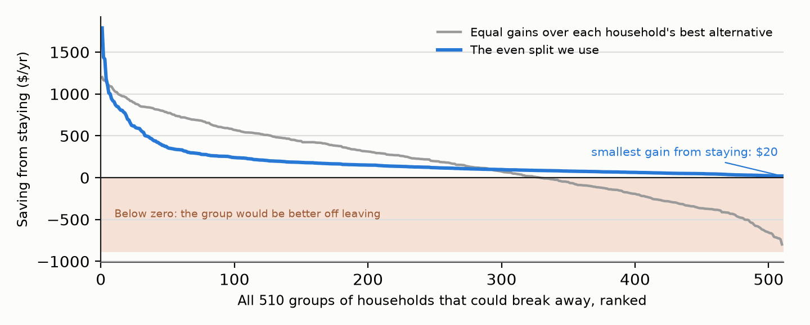

# Cul-de-Watt

**Community Impact Award winner, ComErgy Grand Challenge 2026.**

[View demo](https://jasperdewytt.github.io/cul-de-watt/)

Watt's Mine Is Yours models how nine Sydney households can share solar and batteries, then divide the savings so that households and smaller groups have a financial reason to stay in the community.

In the benchmark simulation, sharing reduced annual community electricity costs by **39%**. Every household saved money, including the household with no solar or battery. The adopted settlement was checked against all **510** possible breakaway groups, each choosing its cheapest of five operating rules. The community has only about **$25/year** of room for extra community-only costs before that stability becomes impossible.

Annual benefit from staying for all 510 possible breakaway groups, ranked separately for each allocation. The adopted settlement keeps every group better off staying against its cheapest of five tested operating rules.

## Read the work

- [Main report](report/ComErgy2026_report.pdf)
- [Technical supplement](report/ComErgy2026_supplement.pdf)
